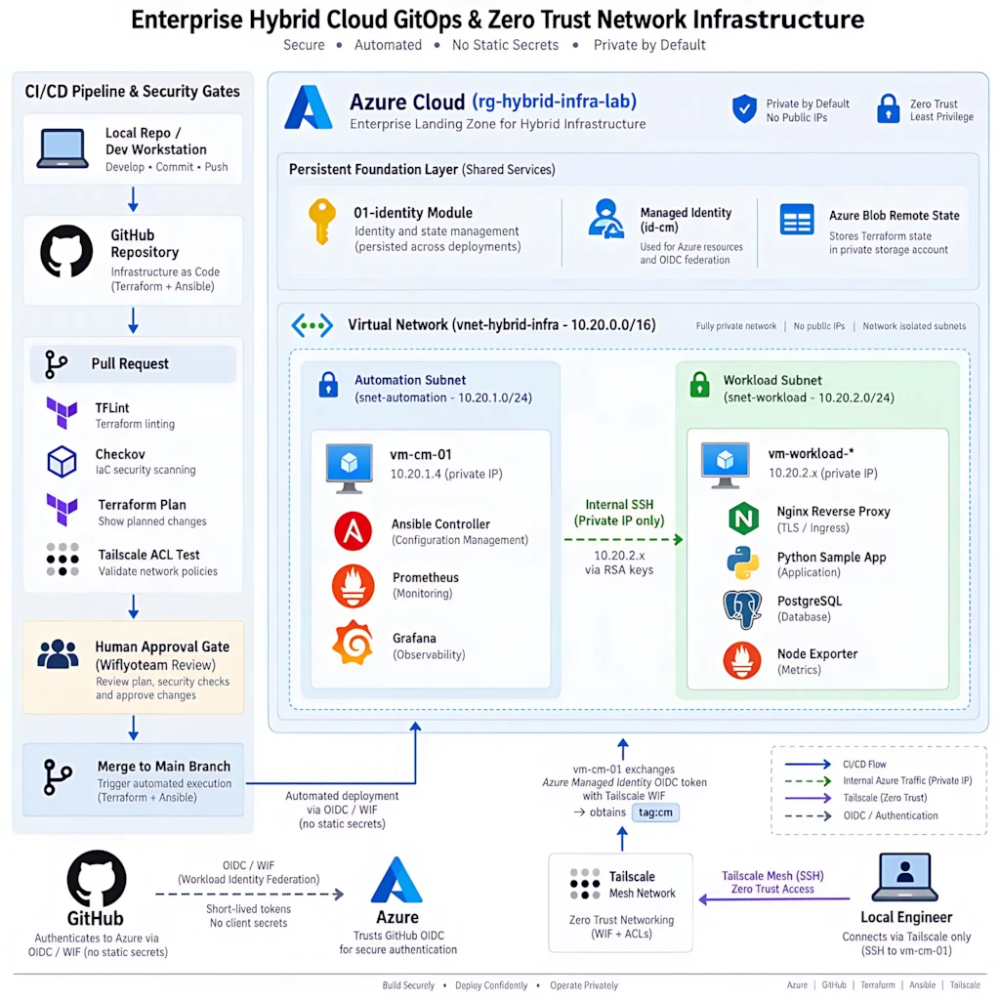

# 🚀 Hybrid Infrastructure Lab (Terraform, Azure, Ansible, GitHub OIDC & Tailscale)

Welcome to the **Hybrid Infrastructure Lab**! 

This repository provides a complete, hands-on blueprint for building a **Zero-Trust, highly secure, and automated hybrid network**. It bridges public cloud resources (Azure) with automated configuration management (Ansible) and modern identity controls (GitHub OIDC & Tailscale Mesh).

---

## 🎯 Why This Lab? (Business & Engineering Benefits)

In traditional infrastructure management, engineering teams often face major challenges:
* ❌ **Security Risks:** Public IPs on internal servers, open SSH ports, and hardcoded passwords or API keys stored in CI/CD variables.
* ❌ **High Operational Costs:** Wasted cloud budget from unoptimized resources and manual setup errors.
* ❌ **Configuration Drift:** Systems configured manually without logs, making it hard to trace who changed what when things break.

### Key Benefits of This Architecture:
1. **Reduce Attack Surface (Zero-Trust):** **0 Public IPs** on Virtual Machines. All management traffic passes through an encrypted Tailscale private mesh network.
2. **Minimize Human Error & Save Time:** Infrastructure is defined as code (**IaC**). Deployment takes minutes instead of hours.
3. **Zero Hardcoded Secrets (Security as Code):** GitHub Actions connects to Azure using **OpenID Connect (OIDC)** and short-lived credentials. No long-lived SSH keys or service principal secrets are stored in GitHub.
4. **Auditability & Traceability:** **GitHub is the Single Source of Truth**. Every infrastructure change requires a **Pull Request (PR)** with mandatory approval gates. Every action leaves a clear execution log.
5. **Least Privilege Access:** Scoped Azure RBAC roles and granular Tailscale ACL rules limit user and CI/CD access to only what is necessary.

---

## 🧰 Tech Stack (Matching Modern NetDevOps Roles)

* **Infrastructure as Code (IaC):** Terraform (`>= 1.6.0`) with remote Azure Blob backend.
* **Configuration Management:** Ansible (Automated baselining, Nginx, PostgreSQL packages, Node Exporter).
* **CI/CD & Pipeline Security:** GitHub Actions + OpenID Connect (OIDC).
* **Private Networking & Access:** Tailscale Mesh VPN, Tailscale SSH, Policy-as-Code (`tailscale/policy.hujson`).
* **Cloud Infrastructure:** Microsoft Azure (VNets, Private Subnets, NSGs, User Assigned Managed Identity).
* **Target OS:** Ubuntu 24.04 ARM64 (`Standard_D2ps_v6`).

---

## 🏗️ Architecture Overview

### 1. Current Implementation (Base Zero-Trust Lab)


### 2. Target Architecture State (Roadmap & Vision)
This diagram illustrates the end-state design including observability (Prometheus/Grafana) and optional ingress load balancing:

[](docs/assets/2610161009-03-Gitops-driven-zero-trust-infrastructure-lab.pdf)

```text
Developer / GitHub PR
        |
        +--> GitHub Actions --OIDC--> Microsoft Entra ID --> Azure RBAC
        |                                  |                    |
        |                                  |                    +--> Terraform state (Azure Blob)
        |                                  +--> Terraform plan/apply
        |                                                       |
        +--> Tailscale policy GitOps ---------------------------+
                                                                |
Azure: rg-hybrid-infra-lab                                     |
  +-- id-cm (User Assigned Managed Identity)                    |
  +-- VNet 10.20.0.0/16                                        |
  |    +-- automation 10.20.1.0/24                              |
  |    |     +-- control-manager VM (tag:cm) <--- Tailscale     |
  |    +-- workload 10.20.2.0/24                                |
  |          +-- workload VM(s) <--- Ansible over private VNet  |
  +-- no VM Public IP / no public SSH                           |

```
Apply `terraform/01-identity` first, then `terraform/02-vmresource`. A successful VM-resource apply can trigger the Ansible deployment workflow. The state storage account and container must exist before Terraform initialization; see [guide 02](docs/02-azure-state-backend.md).

---

## 📂 Repository Structure

- `.github/workflows/` — GitHub Actions workflows for Terraform plan/apply/destroy, Ansible checks/deploy, and Tailscale policy GitOps.
- `terraform/01-identity/` — Persistent Resource Group, managed identity, and `cm_reader` role assignment.
- `terraform/02-vmresource/` — Private network, VMs, NSGs, and optional private Load Balancer scaffolding.
- `bootstrap/` — Control-manager and workload cloud-init scripts.
- `ansible/` — Dynamic inventory generator, playbooks, roles, and templates.
- `tailscale/policy.hujson` — Tags, route approval, grants, and Tailscale SSH rules.
- `docs/` — Ordered setup, verification, troubleshooting, and cleanup instructions.

---

## 🚀 Step-by-Step Setup & Deployment Guide

Follow the numbered setup guides in the `docs/` folder in order:

1. [01 — Prerequisites and clone setup](docs/01-prerequisites-and-clone.md)
2. [02 — Bootstrap the Azure Blob state backend](docs/02-azure-state-backend.md)
3. [03 — Entra OIDC, federated credentials, and Azure RBAC](docs/03-azure-oidc-rbac.md)
4. [04 — Tailscale WIF and policy](docs/04-tailscale-wif-policy.md)
5. [05 — GitHub Environments, secrets, variables, and protection](docs/05-github-environments.md)
6. [06 — Run workflows, deploy, and verify](docs/06-deploy-and-verify.md)
7. [07 — Troubleshooting by checkpoint](docs/07-troubleshooting.md)
8. [08 — Limitations, security, and cleanup](docs/08-limitations-and-cleanup.md)
9. [09 — Clone customization and security audit](docs/09-clone-customization-and-security-audit.md)

---

## ⚠️ Security Notes and Known Limits

- **SSH & Credentials:** Azure Linux VM provisioning uses an administrator SSH public key and disables password authentication. The public key is supplied via `SSH_PUBLIC_KEY` in GitHub Environments. Terraform also generates an internal control-manager-to-workload SSH key stored in state and delivered through cloud-init/custom data. Protect state, plans, artifacts, and cloud-init data; Terraform's `sensitive` flag does not encrypt state.
- **Network Security:** The Ansible workflow joins Tailscale through OIDC and uses OpenSSH to reach the control manager without storing an administrator private key in GitHub. Automation uses trust-on-first-use rather than a pre-pinned host key; workload inventory also discards known-host data, so server identity is not independently verified.
- **Functional Scope:**
  - The sample app is a small HTTP responder on loopback port 8080 proxied by Nginx on port 80. No public internet endpoint.
  - PostgreSQL packages are installed, but no database, schema, or credentials are configured.
  - Node Exporter is installed, but no Prometheus server or dashboard is included.
  - Scale-out, High Availability (HA), and automated failover are not validated.
- **Workflow protections:** PR checks request GitHub OIDC permissions; ensure untrusted PR code cannot obtain Azure credentials or state access. Configure and verify Environment reviewers, branch restrictions, and federated credentials outside the repository.

See [all limitations and cleanup guidance](docs/08-limitations-and-cleanup.md) for more details.

---

## 🔮 Roadmap & Future Enhancements

- [ ] **Cloudflare Tunnel Integration:** Expose private workload web services securely.
- [ ] **High Availability & Load Balancing:** Integrate Azure Load Balancer or Cloudflare Balancer.
- [ ] **Full Observability Stack:** Deploy centralized Prometheus + Grafana and Alertmanager with Lark / Teams notifications.
- [ ] **Self-Healing Automation:** Auto-remediation playbooks for failed services.

---

📜 *This project is for educational and portfolio demonstration purposes. Feel free to clone, modify, and adapt it for your own learning or infrastructure workflows!*